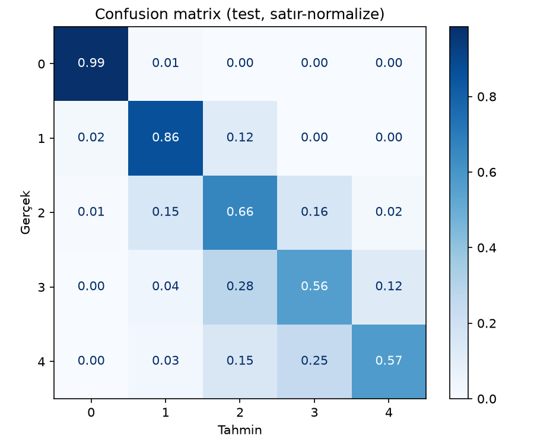
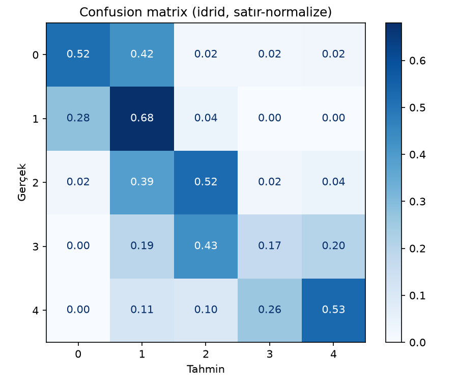

# Retina Görüntülerinden Diyabetik Retinopati Derecelerinin Sınıflandırılması — Final Rapor Taslağı

**Ekip:** VisionDx (58. Proje) · Rümeysa Akbulut · Büşra Yaşar · Meyrem Şenge

> **Yazım kuralları**
> - Sonuçlar yalnız [DENEY_KAYDI.md](DENEY_KAYDI.md)'deki gerçek değerlerden alınır. Henüz yapılmamış iş "planlanmaktadır" diye yazılır.
> - Klinik tanı, tarama veya güvenlik iddiası yok. Sistem akademik bir prototiptir.
> - Kaynaklar [ARASTIRMA.md](ARASTIRMA.md)'deki numaralarla verilir.
> - Her bölümün sorumlusu köşeli parantezde belirtilmiştir.

## Özet *[Ekip — en son yazılır]*
_Deneyler tamamlanınca yazılacak._

## 1. Giriş ve Problem Tanımı *[Ekip]*
Diyabetik retinopati (DR), diyabetin retina dokusunda yol açtığı değişikliklerle ortaya çıkan ve ilerleyen aşamalarda görme kaybına neden olabilen bir göz hastalığıdır. Şiddeti, Uluslararası Klinik DR Ölçeği'ne göre bulgusuz durumdan proliferatif DR'ye kadar beş seviyede değerlendirilir [1]. Fundus görüntülerinin uzmanlarca incelenmesi zaman alır. Derin öğrenme tabanlı yöntemlerin bu görüntülerden DR'yi tespit etmede etkili olabildiği gösterilmiş [2], farklı popülasyonlarda doğrulamanın önemi de vurgulanmıştır [3].

Bu projede, retinal fundus görüntülerinin 0–4 arasındaki beş DR derecesinden birine atanması, transfer öğrenmeyle eğitilen derin öğrenme modelleriyle ele alınmaktadır.

## 2. Amaç ve Kapsam *[Ekip]*
- APTOS 2019 verisini tekrar ve sızıntı kontrolüyle model eğitimine hazırlamak.
- ResNet50 (baseline) ve EfficientNet-B3 modellerini aynı koşullarda eğitip karşılaştırmak.
- Modelleri QWK, macro F1, sınıf bazlı recall ve confusion matrix ile değerlendirmek.
- Seçilen modeli hiç görmediği IDRiD veri setinde test etmek.
- Tahminleri Grad-CAM ile görselleştirmek ve Streamlit arayüzüyle sunmak.

**Kapsam dışı:** klinik kullanım, ensemble, çoklu mimari taraması, hasta düzeyinde analiz.

## 3. İlgili Çalışmalar *[Ekip]*
_Gulshan [2], Ting [3], Krause [4], ResNet [16], EfficientNet [17], Ben Graham [19], Grad-CAM [21]. Her biri için 2–3 cümle._

## 4. Veri Seti *[Rümeysa]*
- **APTOS 2019** [5]: Hindistan'daki Aravind Eye Hospital'dan toplanan ve 2019 Kaggle yarışmasıyla yayımlanan 3.662 etiketli fundus görüntüsü. Etiketler 0–4 ICDR derecesidir. Sınıf dağılımı PLAN 1.6 çıktısıdır (Kaggle, `src/inspect_dataset.py`; notebook: https://www.kaggle.com/code/rmeysaakbulut/notebookb9fd0088e2). Satır sayısı 3.662, tekrarlanan `id_code` 0, geçersiz etiket yok, eksik görüntü dosyası 0:

| Sınıf | 0 | 1 | 2 | 3 | 4 | Toplam |
|---|---|---|---|---|---|---|
| Görüntü | 1805 | 370 | 999 | 193 | 295 | 3662 |
| Oran | %49,3 | %10,1 | %27,3 | %5,3 | %8,1 | |

- **IDRiD** [6]: 516 görüntü, yalnız dış test. Sınıf dağılımı PLAN 3.4 çıktısıdır (`src/prepare_idrid.py`; train 413 + test 103): sınıf 0: 168, sınıf 1: 25, sınıf 2: 168, sınıf 3: 93, sınıf 4: 62.
- Lisans ve kullanım koşulları: APTOS için Kaggle yarışma kuralları (ticari olmayan kullanım, yeniden dağıtım yok) [9], IDRiD için CC BY 4.0.
- **Görüntü özellikleri:** APTOS görüntüleri PNG biçimindedir ve boyutları tekdüze değildir: 17 farklı boyut vardır; en küçüğü 474×358, en büyüğü 4288×2848 pikseldir. En sık görülen boyutlar 1050×1050 (974), 2416×1736 (638), 2588×1958 (533), 3216×2136 (410) ve 2048×1536 (351) pikseldir. Bu nedenle görüntüler eğitimden önce kareye getirilip yeniden boyutlandırılır (§5.1).
- **Kullanılmayan veri:** APTOS'un etiketsiz 1.928 görüntülük yarışma test seti kullanılmamıştır.
- **Sınıf dengesizliği:** Sınıf 0 verinin yaklaşık %49,3'ünü, sınıf 3 ise yalnızca %5,3'ünü oluşturur. Bu yüzden accuracy tek başına yanıltıcıdır; QWK, macro F1 ve sınıf bazlı recall raporlanır (§7).

- **Şekil 4.1** — Her sınıftan bir örnek (dosya: `outputs/figures/ornek_goruntuler.png`; APTOS lisansı nedeniyle görüntü git'e girmez, yalnız yerelde bulunur ve final rapora eklenir).
- **Tekrar görüntü analizi:** _PLAN 2.3 çıktısı: grup sayısı, çıkarılan görüntü, çelişkili grup._

## 5. Yöntem
### 5.1 Ön işleme *[Rümeysa]*
Siyah kenar kırpma, 512×512 önbellek, eğitimde 384 px. Augmentation (çevirme, ±30° döndürme, parlaklık/kontrast) yalnız eğitim verisine uygulanır. Ben Graham ön işlemesi ayrı bir deney olarak (E4) değerlendirilir.
### 5.2 Model *[Büşra]*
ImageNet ağırlıklı ResNet50 [16] ve EfficientNet-B3 [17]. Son katman 5 sınıfa uyarlanır ve tüm ağ ince ayarlanır.
### 5.3 Veri bölme ve sızıntı önleme *[Rümeysa]*
Tekrar politikası (TEKNIK_TASARIM §3), ardından tabakalı 70/15/15 bölme. Test kümesi yalnız final modelle bir kez kullanılır.

## 6. Deney Düzeneği *[Büşra]*
_Donanım (Kaggle P100/T4, RTX 3060), yazılım sürümleri (env.txt), hiperparametre tablosu, deney listesi E1–E4._

## 7. Değerlendirme Metrikleri *[Meyrem]*
Model her görüntü için beş seviyeden (0–4) birini tahmin eder. Başarıyı tek bir sayıyla değil, birbirini tamamlayan ölçülerle değerlendiriyoruz.

### 7.1 Doğruluk (accuracy)

Doğru tahmin edilen görüntülerin tüm görüntülere oranıdır. Anlaşılması kolaydır, ama bu veride yanıltıcıdır: APTOS'un 3.662 görüntüsünün 1.805'i (%49,3) seviye 0'dır. Her görüntüye "0" diyen bir model %49,3 doğruluk alır, oysa hasta olan hiçbir görüntüyü yakalamaz. Aynı model için QWK 0, macro F1 ise 0,132 çıkar (seviye 0'ın F1 değeri 0,660, diğer dört seviyeninki 0'dır; ortalama 0,132). Bu yüzden doğruluk tek başına başarı kanıtı sayılmaz.

### 7.2 Seviye bazlı recall ve macro F1

Recall, bir seviyedeki görüntülerin ne kadarının doğru yakalandığını gösterir. Örneğin seviye 3'teki 20 görüntünün 10'una "3" denmişse seviye 3 için recall 0,5'tir. Precision ise modelin "3" dediği görüntülerin ne kadarının gerçekten seviye 3 olduğudur. F1, bir seviye için recall ile precision'ı tek sayıda birleştirir. Macro F1, beş seviyenin F1 değerlerinin ortalamasıdır ve her seviyeye eşit ağırlık verir.

Seviye 3 ve 4 veride azdır (%5,3 ve %8,1) ama en ağır hastaları temsil eder; bunları kaçırmak en pahalı hatadır. Doğruluk bu seviyelerdeki başarısızlığı gizleyebildiği için recall ve macro F1 ayrıca izlenir.

### 7.3 Karışıklık matrisi (confusion matrix)

5 × 5'lik bir tablodur: satır gerçek seviyeyi, sütun modelin tahminini gösterir. Köşegen doğru tahminleri, köşegen dışındaki hücreler hangi seviyenin hangisiyle karıştırıldığını gösterir. Satır-normalize hâlinde her satır kendi toplamına bölünür; böylece "seviye 3'teki görüntülerin yüzde kaçına hangi seviye denmiş?" sorusu doğrudan okunur ve az görüntülü seviyeler de görünür kalır.

### 7.4 QWK (quadratic weighted kappa)

QWK [18], tahminin gerçek seviyeye ne kadar yakın olduğunu ölçer ve APTOS yarışmasının resmî ölçüsüdür. Fikir şudur: seviye 3 olan bir görüntüye 2 demek, 0 demekten daha hafif bir hatadır. Formül:

    κ = 1 − ( Σ wij · Oij ) / ( Σ wij · Eij )
    wij = (i − j)² / (K − 1)²,  K = 5 (seviye sayısı)

- Oij: gerçek seviyesi i, tahmini j olan görüntü sayısı (karışıklık matrisi).
- Eij: model rastgele tahmin etseydi beklenen sayı. Eij = (gerçek seviyesi i olanların sayısı) × (tahmini j olanların sayısı) / (toplam görüntü).
- wij: hata ağırlığı. Bir basamaklık hata 1/16 = 0,0625, iki basamaklık hata 0,25, dört basamaklık hata (örneğin 0 yerine 4) 1 sayılır. Uzak hata, yakın hatadan 16 kat pahalıdır.

Tam uyumda κ = 1, tahminler şans düzeyindeyse κ = 0 olur.

Küçük bir örnek, 6 görüntü: gerçek seviyeler 0, 0, 1, 2, 3, 4; model 0, 1, 1, 2, 4, 4 demiş. İki hata var ve ikisi de bir basamaklık (0 yerine 1, 3 yerine 4). Formülün payındaki Σ wij · Oij = 2 × (1/16) = 0,125 olur. Paydadaki Σ wij · Eij ise beklenen sayılarla 1,75 çıkar. Böylece κ = 1 − 0,125 / 1,75 = 1 − 1/14 = 13/14 ≈ 0,929. Aynı iki hata birer basamak değil de dört basamak uzağa düşseydi QWK çok daha düşük olurdu.

### 7.5 Final model seçim kuralı

Final model, doğrulama verisinde en yüksek QWK'yı veren modeldir. İki modelin QWK farkı 0,01'den küçükse, seviye 3 ve 4'ün recall ortalaması daha yüksek olan seçilir (karar D-17). Kural sonuçlar görülmeden belirlendi. Seçim yalnız doğrulama verisiyle yapılır; test kümesine ve IDRiD'ye model dondurulduktan sonra yalnız bir kez bakılır.

## 8. Sonuçlar *[Meyrem]*
*(Final model E4: `20261103-1104_efficientnet_b3_ben_graham` (EfficientNet-B3, Ben Graham, ağırlıklı CE). Seçim yalnız doğrulama kümesine göre yapıldı (D-17, D-19); APTOS test ve IDRiD dondurulmuş modelle birer kez kullanıldı (D-08). Sayılar [DENEY_KAYDI.md](DENEY_KAYDI.md) "Final model" tablosundandır.)*

**Model seçimi.** Doğrulama QWK'sı en yüksek deney E4'tür (0,913). İkinci sıradaki E1 (0,903) ile farkı yuvarlanmamış değerlerle 0,0096'dır, yani 0,01'den küçüktür; bu yüzden kural gereği sınıf 3 ve 4'ün recall ortalamasına bakıldı: E4 0,560, E1 0,385. Final model E4 olarak seçildi. E1–E4 karşılaştırması: DENEY_KAYDI "Karşılaştırma (val, E1–E4)".

**Final modelin sonuçları**

| Küme | n | QWK | Macro F1 | Doğruluk | Recall 0 / 1 / 2 / 3 / 4 |
|---|---|---|---|---|---|
| APTOS doğrulama | 522 | 0,913 | 0,672 | 0,818 | 0,974 / 0,686 / 0,681 / 0,520 / 0,600 |
| APTOS test (tek sefer) | 522 | 0,923 | 0,702 | 0,835 | 0,985 / 0,863 / 0,659 / 0,560 / 0,575 |
| IDRiD dış test (tek sefer) | 516 | 0,703 | 0,433 | 0,467 | 0,518 / 0,680 / 0,524 / 0,172 / 0,532 |

**Hedef (FOG-1).** APTOS test QWK'sı 0,923'tür; 0,85 hedefine ulaşıldı. Bu tek koşu ve tek seed sonucudur.

**Doğrulama → test.** Test QWK'sı doğrulamadan 0,010 yüksektir. Fark küçüktür; doğrulamaya göre yapılan model seçiminde aşırı uyum işareti görülmemektedir. Tek koşu olduğu için bu kadar küçük bir fark şansa da bağlı olabilir. Sınıf 3 ve 4'ün recall ortalaması doğrulamada 0,560, testte 0,568'dir; testte bu sınıflar yalnız 25 ve 40 görüntü olduğu için bu değerlerin belirsizliği yüksektir. Testte en sık karışmalar (gerçek → tahmin: adet) 2 → 3: 22, 2 → 1: 21, 4 → 3: 10, 3 → 2: 7, 4 → 2: 6'dır; hataların çoğu komşu sınıflar arasındadır.

**APTOS → IDRiD (dış test).** QWK 0,923'ten 0,703'e (0,220 düşüş), doğruluk 0,835'ten 0,467'ye düştü. En sık karışmalar 0 → 1: 71, 2 → 1: 65, 3 → 2: 40'tır: sınıf 0'ın %42'si ve sınıf 2'nin %39'u sınıf 1 olarak tahmin edildi; sınıf 3'ün recall değeri 0,172'dir. Olası bir açıklama alan kaymasıdır: IDRiD tek bir klinikten ve farklı kameralarla toplanmıştır [6], APTOS ise başka bir merkezden gelir [5]. İki veri seti de Hindistan'dan olduğu için bu sonuç farklı bir merkezdeki başarıyı gösterir, farklı bir hasta topluluğundaki başarıyı göstermez (ARASTIRMA §2). IDRiD küçüktür (516 görüntü; sınıf 1 yalnız 25) ve seviye dağılımı APTOS'tan farklıdır (sınıf 3 ve 4 yaklaşık %30), bu yüzden sınıf bazlı değerlerin belirsizliği büyüktür. Düşüşün nedeni ayrıca incelenmedi; sonuçlar görüldükten sonra model, eşik veya ön işleme değiştirilmedi (D-08).

## 9. Hata Analizi ve Açıklanabilirlik *[Meyrem]*
*(İlk taslak, yalnız doğrulama kümesi, E4: `20261103-1104_efficientnet_b3_ben_graham`, n=522. Test kümesinde hata analizi yapılmaz, D-08.)*

**En sık karışmalar** (gerçek → tahmin: adet): 2 → 1: 21 · 2 → 3: 19 · 1 → 2: 12 · 4 → 3: 8 · 0 → 1: 7. En sık hatalar komşu sınıflar arasındadır (1↔2, 2↔3, 3↔4). QWK komşu sınıf hatalarını az cezalandırdığı için bu, 0,913'lük QWK ile uyumludur.

**Örnek hatalar** (`outputs/figures/errors_val.png`, git dışı; sınıf farkı büyük olan 10 hata): 10 örneğin 5'i gerçek 4 → tahmin 1 veya 2, diğerleri 1 → 3/4 ve 2 → 4 gibi uzak karışmalardır. Gözlemler (tek tek bakışla, kesin değil):
- Bazı görüntülerde sarı parlak odaklar belirgin olduğu hâlde model sınıf 2 veya 4 arasında karışıyor; ağır sınıflar val'de az örnekli olduğu için (sınıf 3: 25, sınıf 4: 40 görüntü; sınıf 0: 268) recall düşük kalıyor (E4: 0,52 / 0,60).
- Gerçek 4 → tahmin 1 olan örnekte (d1a24527a15d) belirgin bir lezyon seçilemiyor; etiket gürültüsü veya modelin yakalayamadığı ince bulgu olabilir. Bu bir tahmindir, klinik yorum değildir.
- Yanlış tahminlerin birçoğu yüksek güvenle (p ≥ 0,7) yapılmıştır; model olasılığı hata sinyali olarak güvenilir değildir.

**Grad-CAM:** E1 ile 3 val görüntüsünde ısı haritası retina üzerinde yoğunlaştı (siyah kenarlarda değil); örneklerin biri lazer izi bölgesini vurguladı. Galeri H5'te (PLAN 5.1) hazırlanacaktır. Isı haritası lezyon tespiti değil, modelin dikkat ettiği bölgelerdir.

## 10. Arayüz *[Meyrem]*
Final model (E4), Streamlit ile hazırlanan tek sayfalık bir arayüze bağlandı (`app/streamlit_app.py`). Kullanıcı bir göz dibi fotoğrafı (PNG/JPG) yükler; sayfa tahmin edilen dereceyi, beş derecenin olasılıklarını 0–4 sırasıyla ve Grad-CAM ısı haritasını kırpılmış görüntünün yanında gösterir. Açılamayan veya 224 pikselden küçük dosyalar için hata mesajı verilir. "Akademik prototiptir; tıbbi teşhis yerine geçmez." uyarısı her ekranda görünür; yüklenen görüntü yalnız bellekte işlenir, diske yazılmaz. Arayüz internet bağlantısı gerektirmez. Çalıştırma: README "Model ağırlıkları ve demo".

**GPU'suz yanıt süresi (FOG-5, hedef ≤ 10 sn).** Ölçüm 12 Kasım 2026'da, GPU gizlenerek (`CUDA_VISIBLE_DEVICES=-1`) AMD Ryzen 7 6800H (8 çekirdek / 16 iş parçacığı), 15,3 GB RAM'li bir dizüstü bilgisayarda yapıldı. Süre, arayüzün çağırdığı `explain_image` fonksiyonunun (ön işleme + tahmin + Grad-CAM) süresidir; her sınıftan bir val görüntüsü kullanıldı, ilk (ısınma) çalıştırma ortalamaya katılmadı. Ölçüm arayüze tıklanarak değil, aynı fonksiyonu çağıran bir betikle yapıldı; sayfa çizimi bu süreye dahil değildir.

| Ölçüm | Gerçek sınıf | Süre |
|---|---|---|
| 1 | 0 | 0,65 sn |
| 2 | 1 | 0,60 sn |
| 3 | 2 | 0,59 sn |
| 4 | 3 | 0,59 sn |
| 5 | 4 | 0,47 sn |

Ortalama 0,58 sn, en kötü 0,65 sn; hedef karşılandı. Model dosyasının yüklenmesi ayrıca 0,2 sn sürdü (arayüzde bir kez yapılır).

## 11. Sınırlılıklar ve Etik *[Ekip]*
- APTOS ve IDRiD Hindistan kaynaklı; popülasyon çeşitliliği sınırlı.
- APTOS'ta hasta kimliği yok, hasta düzeyinde sızıntı tamamen dışlanamaz.
- Etiketlerde uzmanlar arası farklılık var [4]; çelişkili tekrarlar bunun göstergesi.
- Sistem klinik olarak doğrulanmamıştır, tanı amacıyla kullanılamaz. Arayüz yüklenen görüntüyü saklamaz.

## 12. Sonuç ve Gelecek Çalışmalar *[Ekip]*
_Sonuçlara göre. Aday konular: Messidor-2, regresyon + eşik, daha yüksek çözünürlük._

## Kaynakça
ARASTIRMA.md → "Kaynaklar" listesinden yalnız metinde atıf yapılanlar alınır.
