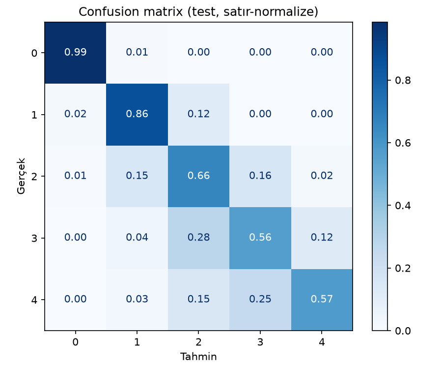
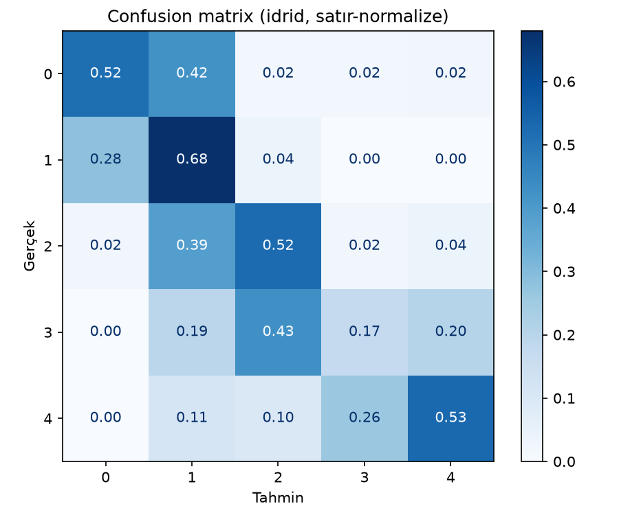

# Retina Görüntülerinden Diyabetik Retinopati Derecelerinin Sınıflandırılması — Final Rapor Taslağı

**Ekip:** VisionDx (58. Proje) · Rümeysa Akbulut · Büşra Yaşar · Meyrem Şenge

> **Yazım kuralları**
> - Sonuçlar yalnız [DENEY_KAYDI.md](DENEY_KAYDI.md)'deki gerçek değerlerden alınır. Henüz yapılmamış iş "planlanmaktadır" diye yazılır.
> - Klinik tanı, tarama veya güvenlik iddiası yok. Sistem akademik bir prototiptir.
> - Kaynaklar [ARASTIRMA.md](ARASTIRMA.md)'deki numaralarla verilir.
> - Her bölümün sorumlusu köşeli parantezde belirtilmiştir.

## Özet *[Ekip — en son yazılır]*
*(Taslak — sayılar §8'den; Meyrem DENEY_KAYDI ve veri raporuyla doğruladı.)*

Diyabetik retinopati (DR), tedavi edilmediğinde görme kaybına yol açabilen bir diyabet komplikasyonudur. Bu çalışmada retina fundus görüntülerini beş DR derecesinden (0–4) birine atayan bir derin öğrenme prototipi geliştirilmiştir. APTOS 2019 verisindeki 3.662 görüntüde algısal özetle 139 tekrar grubu bulunmuş, tekrarlar ve çelişkili etiketli gruplar çıkarıldıktan sonra kalan 3.477 görüntü tabakalı olarak %70/15/15 eğitim, doğrulama ve test kümelerine ayrılmıştır. ImageNet ağırlıklı ResNet50 ve EfficientNet-B3 modelleri transfer öğrenmeyle eğitilmiş; ağırlıklı çapraz entropi ve Ben Graham ön işlemesinin etkisi ayrı deneylerle incelenmiştir. Doğrulama kümesine göre önceden belirlenen kuralla seçilen EfficientNet-B3 + ağırlıklı çapraz entropi + Ben Graham modeli, APTOS test kümesinde 0,923 QWK, 0,702 macro F1 ve 0,835 doğruluk elde etmiştir. Aynı model, farklı bir klinikten toplanan IDRiD verisinde 0,703 QWK'ye düşmüş; bu, tek merkezli veriyle eğitilen modelin genelleme sınırını göstermektedir. Modelin kararları Grad-CAM ile görselleştirilmiş ve GPU'suz bir bilgisayarda çalışan bir Streamlit arayüzüyle sunulmuştur. Sistem akademik bir prototiptir; tıbbi teşhis yerine geçmez.

**Anahtar kelimeler:** diyabetik retinopati, fundus görüntüsü, transfer öğrenme, EfficientNet, QWK, Grad-CAM

## 1. Giriş ve Problem Tanımı *[Ekip]*
Diyabetik retinopati (DR), diyabetin retina dokusunda yol açtığı değişikliklerle ortaya çıkan ve ilerleyen aşamalarda görme kaybına neden olabilen bir göz hastalığıdır. Şiddeti, Uluslararası Klinik DR Ölçeği'ne göre bulgusuz durumdan proliferatif DR'ye kadar beş seviyede değerlendirilir [1]. Fundus görüntülerinin uzmanlarca incelenmesi zaman alır. Derin öğrenme tabanlı yöntemlerin bu görüntülerden DR'yi tespit etmede etkili olabildiği gösterilmiş [2], farklı popülasyonlarda doğrulamanın önemi de vurgulanmıştır [3].

Bu projede, retinal fundus görüntülerinin 0–4 arasındaki beş DR derecesinden birine atanması, transfer öğrenmeyle eğitilen derin öğrenme modelleriyle ele alınmaktadır.

## 2. Amaç ve Kapsam *[Ekip]*
- APTOS 2019 verisini tekrar ve sızıntı kontrolüyle model eğitimine hazırlamak.
- ResNet50 (baseline) ve EfficientNet-B3 modellerini aynı koşullarda eğitip karşılaştırmak.
- Modelleri QWK, macro F1, sınıf bazlı recall ve confusion matrix ile değerlendirmek.
- Seçilen modeli hiç görmediği IDRiD veri setinde test etmek.
- Tahminleri Grad-CAM ile görselleştirmek ve Streamlit arayüzüyle sunmak.

**Kapsam dışı:** klinik kullanım, ensemble, çoklu mimari taraması, hasta düzeyinde analiz.

## 3. İlgili Çalışmalar *[Ekip]*
*(Taslak — içerdiği sayılar Meyrem tarafından DENEY_KAYDI ile doğrulandı.)*

**Derin öğrenmeyle DR tespiti.** Gulshan ve ark. [2], fundus görüntülerinden DR tespitinde derin öğrenme tabanlı bir algoritmanın etkili olabildiğini gösteren öncü çalışmalardandır. Ting ve ark. [3], benzer bir sistemi farklı etnik kökenden hastaları içeren çok merkezli veride doğrulamış ve bir modelin eğitildiği topluluk dışında da sınanması gerektiğini vurgulamıştır. Bu, projemizde final modelin hiç görmediği IDRiD verisinde ayrıca test edilmesinin gerekçesidir.

**Etiket güvenilirliği.** Krause ve ark. [4], uzmanlar arasındaki derecelendirme farklılığının yüksek olduğunu ve birden fazla uzmanın uzlaşısıyla elde edilen etiketlerin model değerlendirmesini belirgin biçimde değiştirdiğini göstermiştir. APTOS'ta aynı görüntünün farklı derecelerle etiketlendiği çelişkili tekrar grupları (§4) bu bulguyla uyumludur.

**Mimariler.** ResNet [16], artık (residual) bağlantılarla çok derin ağların eğitilebilmesini sağlamış ve görüntü sınıflandırmada yaygın bir baseline olmuştur. EfficientNet [17], ağın derinliğini, genişliğini ve girdi çözünürlüğünü birlikte ölçekleyerek benzer doğruluğa daha az parametreyle ulaşır. APTOS üzerinde tek bir ResNet50 için bildirilen QWK değerleri, kullanılan bölme ve ön işlemeye göre yaklaşık 0,86–0,92 arasındadır [14][15]; bu çalışmalar farklı bölmeler kullandığından sonuçlarımızla doğrudan karşılaştırılamaz.

**Ön işleme.** Ben Graham [19], 2015 Kaggle DR yarışmasında görüntüden Gauss bulanıklığıyla tahmin edilen arka planı çıkararak aydınlatma farklarını azaltan bir ön işleme kullanmış ve yarışmayı kazanmıştır. Projede bu yöntem E4 deneyinde sınanmıştır.

**Açıklanabilirlik.** Grad-CAM [21], son evrişim katmanının gradyanlarından sınıfa özgü bir ısı haritası üreterek modelin karar verirken görüntünün hangi bölgelerine ağırlık verdiğini gösterir. Bu harita lezyon tespiti değildir; projede modelin dikkatini görselleştirmek için kullanılmıştır (§9).

## 4. Veri Seti *[Rümeysa]*
- **APTOS 2019** [5]: Hindistan'daki Aravind Eye Hospital'dan toplanan ve 2019 Kaggle yarışmasıyla yayımlanan 3.662 etiketli fundus görüntüsü. Etiketler 0–4 ICDR derecesidir. Sınıf dağılımı PLAN 1.6 çıktısıdır (Kaggle, `src/inspect_dataset.py`; notebook: https://www.kaggle.com/code/rmeysaakbulut/notebookb9fd0088e2). Satır sayısı 3.662, tekrarlanan `id_code` 0, geçersiz etiket yok, eksik görüntü dosyası 0:

| Sınıf | 0 | 1 | 2 | 3 | 4 | Toplam |
|---|---|---|---|---|---|---|
| Görüntü | 1805 | 370 | 999 | 193 | 295 | 3662 |
| Oran | %49,3 | %10,1 | %27,3 | %5,3 | %8,1 | |

- **IDRiD** [6]: 516 görüntü, yalnız dış test. Sınıf dağılımı PLAN 3.4 çıktısıdır (`src/prepare_idrid.py`; train 413 + test 103): sınıf 0: 168, sınıf 1: 25, sınıf 2: 168, sınıf 3: 93, sınıf 4: 62.
- Lisans ve kullanım koşulları: APTOS için Kaggle yarışma kuralları (ticari olmayan kullanım, yeniden dağıtım yok) [9], IDRiD için CC BY 4.0.
- **Görüntü özellikleri:** APTOS görüntüleri PNG biçimindedir ve boyutları tekdüze değildir: 17 farklı boyut vardır; en küçüğü 474×358, en büyüğü 4288×2848 pikseldir. En sık görülen boyutlar 1050×1050 (974), 2416×1736 (638), 2588×1958 (533), 3216×2136 (410) ve 2048×1536 (351) pikseldir. Bu nedenle görüntüler eğitimden önce kareye getirilip yeniden boyutlandırılır (§5.1).
- **Kullanılmayan veri:** APTOS'un etiketsiz 1.928 görüntülük yarışma test seti kullanılmamıştır.
- **Sınıf dengesizliği:** Sınıf 0 verinin yaklaşık %49,3'ünü, sınıf 3 ise yalnızca %5,3'ünü oluşturur. Bu yüzden accuracy tek başına yanıltıcıdır; QWK, macro F1 ve sınıf bazlı recall raporlanır (§7).

- **Şekil 4.1** — Her sınıftan bir örnek (dosya: `outputs/figures/ornek_goruntuler.png`; APTOS lisansı nedeniyle görüntü git'e girmez, yalnız yerelde bulunur ve final rapora eklenir).
- **Tekrar görüntü analizi** (PLAN 2.3, `src/find_duplicates.py`): 3.662 görüntüde birebir aynı (MD5) 134 çift ve pHash mesafesi 0 olan 158 çift bulundu. Bu çiftler birleştirilince **139 tekrar grubu** (toplam 287 görüntü) oluştu; bunların **37'sinde** grup içindeki etiketler birbirini tutmuyor (çelişkili etiket). Çelişkili gruplar, aynı görüntünün farklı derecelerle etiketlenebildiğini, yani etiket gürültüsünü gösterir. Bu görüntülerin nasıl elendiği §5.3'te anlatılmıştır.

## 5. Yöntem
### 5.1 Ön işleme *[Rümeysa]*
Ön işleme iki aşamada yapılır.

**Tek seferlik önbellek** (`src/preprocess_images.py`): Her görüntü RGB'ye çevrilir, gri tonda eşik değeri 7'nin altında kalan siyah kenarlar kırpılır, kısa kenar siyahla doldurularak en-boy oranı korunur ve görüntü 512×512 piksele küçültülüp JPEG (kalite 95) olarak kaydedilir. Böylece §4'te görülen 17 farklı boyut tek bir boyuta iner ve eğitim sırasında büyük PNG dosyalarının tekrar tekrar okunması önlenir.

**Ben Graham dönüşümü** (E4 ve final model): Görüntüden Gauss bulanıklığıyla elde edilen arka plan çıkarılır (`4·görüntü − 4·bulanık + 128`, σ = yarıçap/30) ve retina dışında kalan bölge gri bir dairesel maskeyle örtülür [19]. Amaç, aydınlatma farklarını azaltıp mikroanevrizma ve kanama gibi küçük ayrıntıları belirginleştirmektir. Bu dönüşüm JPEG kaydından **önce** uygulanır ve ayrı bir önbellek (`aptos_512_bg`) olarak saklanır. Dönüşüm OpenCV kullanılmadan Pillow ve NumPy ile yazılmıştır.

**Eğitim sırasında** (`src/data.py`): Görüntüler 384×384'e boyutlandırılır ve ImageNet ortalama/standart sapmasıyla normalize edilir. Yalnız eğitim kümesine veri artırma uygulanır: yatay ve dikey çevirme, ±30° döndürme, %20 parlaklık ve kontrast değişimi. Doğrulama, test, IDRiD ve demo aynı deterministik zinciri kullanır (veri artırma yok). IDRiD görüntüleri de aynı kırpma, 512 önbellek ve Ben Graham adımlarından geçirilmiştir (`src/prepare_idrid.py`).
### 5.2 Model *[Büşra]*
Sıfırdan eğitim için 2.433 eğitim görüntüsü azdır. Bu yüzden ImageNet üzerinde önceden eğitilmiş iki evrişimli ağ, transfer öğrenmeyle kullanılmıştır (`src/models.py`, torchvision):

- **ResNet50** [16] (baseline, torchvision `IMAGENET1K_V2` ağırlıkları): Artık (residual) bağlantılarla derin ağların eğitimini kolaylaştıran, yaygın kullanılan bir mimari. Son tam bağlı katman (`fc`) 5 çıkışlı yeni bir katmanla değiştirilmiştir.
- **EfficientNet-B3** [17] (karşılaştırma, `IMAGENET1K_V1` ağırlıkları): Derinlik, genişlik ve çözünürlüğü birlikte ölçekleyen, ResNet50'den daha az parametreli bir mimari. Sınıflandırıcının son doğrusal katmanı (`classifier[1]`) 5 çıkışlı yeni bir katmanla değiştirilmiştir.

Her iki modelde hiçbir katman dondurulmamış, ağın tamamı ince ayarlanmıştır (fine-tuning). Model çıkışı 5 sınıf için olasılıktır; tahmin en yüksek olasılıklı sınıftır (ek eşik ayarı yapılmamıştır). ResNet18 yalnız kodun çalıştığını göstermek için duman testinde kullanılmış, sonuçları raporlanmamıştır.

**Kayıp fonksiyonu:** E1 ve E2'de çapraz entropi (CE), E3 ve E4'te sınıf dengesizliğini telafi etmek için **ağırlıklı çapraz entropi** kullanılmıştır. Ağırlıklar eğitim kümesinden `w_c = N / (5 · n_c)` ile hesaplanır (N: eğitim görüntüsü sayısı, n_c: c sınıfındaki görüntü sayısı). Böylece az görülen sınıflardaki hata daha çok cezalandırılır. Eğitim kümesi için hesaplanan ağırlıklar: sınıf 0: 0,389 · 1: 2,062 · 2: 0,754 · 3: 4,124 · 4: 2,645.

**Final model:** Doğrulama sonuçlarına göre önceden belirlenmiş kural (§7.5, karar D-17) ile E4 (EfficientNet-B3 + ağırlıklı CE + Ben Graham) seçilmiş ve dondurulmuştur (karar D-19).
### 5.3 Veri bölme ve sızıntı önleme *[Rümeysa]*
Aynı görüntünün hem eğitim hem test kümesine düşmesi, modelin ezberini başarı gibi gösterir (veri sızıntısı). Bunu önlemek için bölmeden **önce** tekrar analizi yapılmıştır (§4).

**Tekrar tespiti:** Birebir aynı dosyalar MD5 içerik özetiyle, çok benzer görüntüler 64 bitlik algısal özet (pHash) ile bulunur ve birleşim-bul (union-find) yöntemiyle gruplanır. pHash için başlangıçta Hamming mesafesi ≤ 4 eşiği planlanmıştı. Ancak gerçek veride bu eşik zincirleme yanlış eşleşmelere yol açtı: tek bir grupta 248 görüntü toplandı (toplam 249 grup, 1.384 görüntü). Eşik 0'a çekildiğinde 139 grup, 287 görüntü ve 37 çelişkili grup elde edildi; bu sayılar literatürdeki beklentiyle uyumludur. Bu nedenle eşik 0 seçilmiştir (karar D-18).

**Tekrar politikası** (karar D-07): Etiketleri aynı olan grupta yalnız bir temsilci (en küçük `id_code`) tutulur, diğerleri çıkarılır. Etiketleri çelişkili grubun tamamı çıkarılır, çünkü hangi etiketin doğru olduğu bilinemez. Sonuçta 185 görüntü elenmiştir: 106 tekrar, 79 çelişkili etiket.

**Bölme:** Kalan 3.477 görüntü, sınıf oranları korunarak (tabakalı) %70 eğitim, %15 doğrulama ve %15 test olarak bölünmüştür (seed 42):

| Küme | Sınıf 0 | 1 | 2 | 3 | 4 | Toplam |
|---|---|---|---|---|---|---|
| Eğitim | 1250 | 236 | 645 | 118 | 184 | 2433 |
| Doğrulama | 268 | 51 | 138 | 25 | 40 | 522 |
| Test | 268 | 51 | 138 | 25 | 40 | 522 |

Bölme `splits/aptos_splits.csv` dosyasına bir kez yazılmış ve sonra değiştirilmemiştir; dosya etiket içermez, yalnız `id_code`, küme ve not sütunlarını tutar. Tüm deneyler aynı bölmeyi kullanır.

**Kullanım kuralı:** Model seçimi, erken durdurma ve hiperparametre kararları yalnız doğrulama kümesiyle verilmiştir. Test kümesi ve IDRiD, dondurulmuş final modelle (E4) birer kez kullanılmıştır (karar D-08); sonuçlar görüldükten sonra model veya ön işleme değiştirilmemiştir.

**Sınırlılık:** APTOS'ta hasta kimliği bulunmadığından, aynı hastanın farklı görüntülerinin farklı kümelere düşmesi tamamen önlenemez (§11).

## 6. Deney Düzeneği *[Büşra]*
**Donanım ve yazılım:** Raporlanan tüm eğitimler Kaggle'ın ücretsiz **NVIDIA Tesla T4** (16 GB) GPU'sunda yapılmıştır. Kaggle ortamında PyTorch 2.11.0 (CUDA 12.8) kullanılmıştır; final koşunun (E4) ortamı: Python 3.13, PyTorch 2.11.0+cu128, torchvision 0.26.0, commit 357e92f. Her koşu kendi klasörüne kodun git commit'ini, kütüphane sürümlerini ve cihazı (`env.txt`) ile kullanılan ayarları (`config.yaml`) yazar. Böylece her sonuç, hangi kodla üretildiğine kadar izlenebilir. Proje kodu yerelde Python 3.12 ve PyTorch 2.14 ile de test edilmiştir.

**Ortak hiperparametreler** (tüm deneylerde aynı, `configs/*.yaml`):

| Ayar | Değer |
|---|---|
| Girdi boyutu | 384 × 384 |
| Batch boyutu | 16 |
| En çok epoch | 15 |
| Optimizer | AdamW, öğrenme oranı 1·10⁻⁴, ağırlık azaltma (weight decay) 1·10⁻⁴ |
| Öğrenme oranı takvimi | Kosinüs azalma (15 epoch) |
| Karışık hassasiyet | Açık (float16, yalnız GPU) |
| Erken durdurma | Doğrulama QWK'si 4 epoch boyunca iyileşmezse durur; en iyi QWK'li epoch saklanır |
| Seed | 42 (`src.utils.set_seed`) |
| Bölme | Aynı `splits/aptos_splits.csv` (§5.3) |

**Deneyler:** Her deney bir öncekinden **tek bir şeyi** değiştirir, böylece farkın nedeni yorumlanabilir.

| Deney | Model | Ön işleme | Kayıp | Neyi sınar |
|---|---|---|---|---|
| E1 | ResNet50 | Kırpma + 512 | CE | Baseline |
| E2 | EfficientNet-B3 | Kırpma + 512 | CE | Mimari farkı (E1'e göre) |
| E3 | EfficientNet-B3 | Kırpma + 512 | Ağırlıklı CE | Sınıf dengesizliği (E2'ye göre) |
| E4 | EfficientNet-B3 | Kırpma + 512 + Ben Graham | Ağırlıklı CE | Ön işleme (E3'e göre) |

Model seçimi, erken durdurma ve tüm karşılaştırmalar yalnız doğrulama kümesiyle (n = 522) yapılmıştır. Her deney tek seed ile bir kez koşulmuştur. Bu yüzden aynı ayarlarla yeniden eğitimin sonucu ne kadar değiştirdiği ayrıca ölçülmüştür: final config (E4) aynı kod, veri ve seed (42) ile Kaggle T4'te ikinci kez eğitilmiş, doğrulama QWK'si 0,9126'dan 0,9182'ye çıkmıştır (fark **0,0056**; hedef ≤ 0,01). Fark, GPU işlemlerinin tam belirlenimci olmamasından ve Kaggle'daki CUDA sürüm değişikliğinden (12.8 → 13.0) kaynaklanabilir. Bu nedenle deneyler arasındaki yaklaşık 0,006'dan küçük QWK farkları anlamlı kabul edilmemelidir. İkinci eğitim yalnız ölçüm içindir; final model değiştirilmemiştir. Eğitim süreleri ve sonuçlar §8'dedir.

**5 katlı çapraz doğrulama (E5):** Sonucun tek bir bölmeye ne kadar bağlı olduğunu görmek için final ayar (E4), eğitim ve doğrulama kümelerinin birleşimi (2.955 görüntü) üzerinde, sınıf oranları korunarak 5 parçaya bölünmüş (`--fold`, seed 42) ve her parça bir kez doğrulama kümesi olacak şekilde 5 kez eğitilmiştir (Kaggle T4, toplam yaklaşık 55 dk). Test kümesi ve IDRiD kullanılmamıştır; final model değiştirilmemiştir. Doğrulama QWK'leri 0,921 / 0,896 / 0,886 / 0,888 / 0,919, ortalama **0,902 ± 0,017**'dir (örneklem standart sapması; DENEY_KAYDI "5-fold"). Tekrar görüntüler bölmeden önce elendiği için (§5.3) parçalar arasında sızıntı beklenmez. Tek bölmedeki E4 sonucu (0,913) bu aralığın içindedir.

## 7. Değerlendirme Metrikleri *[Meyrem]*
Model her görüntü için beş DR derecesinden birini (sınıf 0–4) tahmin eder. Başarıyı tek bir sayıyla değil, birbirini tamamlayan ölçülerle değerlendiriyoruz.

### 7.1 Doğruluk (accuracy)

Doğru tahmin edilen görüntülerin tüm görüntülere oranıdır. Anlaşılması kolaydır, ama bu veride yanıltıcıdır: APTOS'un 3.662 görüntüsünün 1.805'i (%49,3) sınıf 0'dır. Her görüntüye "0" diyen bir model %49,3 doğruluk alır, oysa hasta olan hiçbir görüntüyü yakalamaz. Aynı model için QWK 0, macro F1 ise 0,132 çıkar (sınıf 0'ın F1 değeri 0,660, diğer dört sınıfınki 0'dır; ortalama 0,132). Bu yüzden doğruluk tek başına başarı kanıtı sayılmaz.

### 7.2 Sınıf bazlı recall ve macro F1

Recall, bir sınıftaki görüntülerin ne kadarının doğru yakalandığını gösterir. Örneğin sınıf 3'teki 20 görüntünün 10'una "3" denmişse sınıf 3 için recall 0,5'tir. Precision ise modelin "3" dediği görüntülerin ne kadarının gerçekten sınıf 3 olduğudur. F1, bir sınıf için recall ile precision'ı tek sayıda birleştirir. Macro F1, beş sınıfın F1 değerlerinin ortalamasıdır ve her sınıfa eşit ağırlık verir.

Sınıf 3 ve 4 veride azdır (%5,3 ve %8,1) ama en ağır hastaları temsil eder; bunları kaçırmak en pahalı hatadır. Doğruluk bu sınıflardaki başarısızlığı gizleyebildiği için recall ve macro F1 ayrıca izlenir.

### 7.3 Karışıklık matrisi (confusion matrix)

5 × 5'lik bir tablodur: satır gerçek sınıfı, sütun modelin tahminini gösterir. Köşegen doğru tahminleri, köşegen dışındaki hücreler hangi sınıfın hangisiyle karıştırıldığını gösterir. Satır-normalize hâlinde her satır kendi toplamına bölünür; böylece "sınıf 3'teki görüntülerin yüzde kaçına hangi sınıf denmiş?" sorusu doğrudan okunur ve az görüntülü sınıflar de görünür kalır.

### 7.4 QWK (quadratic weighted kappa)

QWK [18], tahminin gerçek sınıfa ne kadar yakın olduğunu ölçer ve APTOS yarışmasının resmî ölçüsüdür. Fikir şudur: sınıf 3 olan bir görüntüye 2 demek, 0 demekten daha hafif bir hatadır. Formül:

    κ = 1 − ( Σ wij · Oij ) / ( Σ wij · Eij )
    wij = (i − j)² / (K − 1)²,  K = 5 (sınıf sayısı)

- Oij: gerçek sınıfı i, tahmini j olan görüntü sayısı (karışıklık matrisi).
- Eij: model rastgele tahmin etseydi beklenen sayı. Eij = (gerçek sınıfı i olanların sayısı) × (tahmini j olanların sayısı) / (toplam görüntü).
- wij: hata ağırlığı. Bir basamaklık hata 1/16 = 0,0625, iki basamaklık hata 0,25, dört basamaklık hata (örneğin 0 yerine 4) 1 sayılır. Dört basamaklık hata, bir basamaklık hatadan 16 kat pahalıdır.

Tam uyumda κ = 1, tahminler şans düzeyindeyse κ = 0 olur.

Küçük bir örnek, 6 görüntü: gerçek sınıflar 0, 0, 1, 2, 3, 4; model 0, 1, 1, 2, 4, 4 demiş. İki hata var ve ikisi de bir basamaklık (0 yerine 1, 3 yerine 4). Formülün payındaki Σ wij · Oij = 2 × (1/16) = 0,125 olur. Paydadaki Σ wij · Eij ise beklenen sayılarla 1,75 çıkar. Böylece κ = 1 − 0,125 / 1,75 = 1 − 1/14 = 13/14 ≈ 0,929. Aynı iki hata birer basamak değil de dört basamak uzağa düşseydi QWK çok daha düşük olurdu.

### 7.5 Final model seçim kuralı

Final model, doğrulama kümesinde en yüksek QWK'yı veren modeldir. İki modelin QWK farkı 0,01'den küçükse, sınıf 3 ve 4'ün recall ortalaması daha yüksek olan seçilir (karar D-17). Kural sonuçlar görülmeden belirlendi. Seçim yalnız doğrulama kümesiyle yapılır; test kümesine ve IDRiD'ye model dondurulduktan sonra yalnız bir kez bakılır.

## 8. Sonuçlar *[Meyrem]*
*(Final model E4: `20261103-1104_efficientnet_b3_ben_graham` (EfficientNet-B3, Ben Graham, ağırlıklı CE). Seçim yalnız doğrulama kümesine göre yapıldı (D-17, D-19); APTOS test ve IDRiD dondurulmuş modelle birer kez kullanıldı (D-08). Sayılar [DENEY_KAYDI.md](DENEY_KAYDI.md) "Final model" tablosundandır.)*

**Model seçimi.** Doğrulama QWK'sı en yüksek deney E4'tür (0,913). İkinci sıradaki E1 (0,903) ile farkı yuvarlanmamış değerlerle 0,0096'dır, yani 0,01'den küçüktür; bu yüzden kural gereği sınıf 3 ve 4'ün recall ortalamasına bakıldı: E4 0,560, E1 0,385. Final model E4 olarak seçildi. E1–E4 karşılaştırması: DENEY_KAYDI "Karşılaştırma (val, E1–E4)".

**Final modelin sonuçları**

| Küme | n | QWK | Macro F1 | Doğruluk | Recall 0 / 1 / 2 / 3 / 4 |
|---|---|---|---|---|---|
| APTOS doğrulama | 522 | 0,913 | 0,672 | 0,818 | 0,974 / 0,686 / 0,681 / 0,520 / 0,600 |
| APTOS test (tek sefer) | 522 | 0,923 | 0,702 | 0,835 | 0,985 / 0,863 / 0,659 / 0,560 / 0,575 |
| IDRiD dış test (tek sefer) | 516 | 0,703 | 0,433 | 0,467 | 0,518 / 0,680 / 0,524 / 0,172 / 0,532 |

**Hedef (FOG-1).** APTOS test QWK'sı 0,923'tür; 0,85 hedefine ulaşıldı. Test sonucu tek koşu ve tek seed ile elde edilmiştir. 5 katlı çapraz doğrulamanın ortalaması (aşağıda) da 0,85'in üzerindedir.

**5 katlı çapraz doğrulama (E5).** Final ayar, eğitim ve doğrulama kümelerinin birleşimi üzerinde 5 kez eğitildi (yöntem: §6); test kümesi kullanılmadı.

| Fold | 1 | 2 | 3 | 4 | 5 | Ortalama ± std |
|---|---|---|---|---|---|---|
| Doğrulama QWK | 0,921 | 0,896 | 0,886 | 0,888 | 0,919 | 0,902 ± 0,017 |

Her fold'da en iyi epoch o fold'un doğrulama parçasına göre seçildiği ve final ayar daha önce doğrulama kümesine bakılarak belirlendiği için bu değerler bir miktar iyimser olabilir.

**Doğrulama → test.** Test QWK'sı doğrulamadan 0,010 yüksektir. Fark küçüktür; doğrulamaya göre yapılan model seçiminde aşırı uyum işareti görülmemektedir. Tek koşu olduğu için bu kadar küçük bir fark şansa da bağlı olabilir. Sınıf 3 ve 4'ün recall ortalaması doğrulamada 0,560, testte 0,568'dir; testte bu sınıflar yalnız 25 ve 40 görüntü olduğu için bu değerlerin belirsizliği yüksektir. Testte en sık karışmalar (gerçek → tahmin: adet) 2 → 3: 22, 2 → 1: 21, 4 → 3: 10, 3 → 2: 7, 4 → 2: 6'dır; hataların çoğu komşu sınıflar arasındadır.

**APTOS → IDRiD (dış test).** QWK 0,923'ten 0,703'e (0,220 düşüş), doğruluk 0,835'ten 0,467'ye düştü. En sık karışmalar 0 → 1: 71, 2 → 1: 65, 3 → 2: 40'tır: sınıf 0'ın %42'si ve sınıf 2'nin %39'u sınıf 1 olarak tahmin edildi; sınıf 3'ün recall değeri 0,172'dir. Olası bir açıklama alan kaymasıdır: IDRiD tek bir klinikten ve farklı kameralarla toplanmıştır [6], APTOS ise başka bir merkezden gelir [5]. İki veri seti de Hindistan'dan olduğu için bu sonuç farklı bir merkezdeki başarıyı gösterir, farklı bir hasta topluluğundaki başarıyı göstermez (ARASTIRMA §2). IDRiD küçüktür (516 görüntü; sınıf 1 yalnız 25) ve sınıf dağılımı APTOS'tan farklıdır (sınıf 3 ve 4 yaklaşık %30), bu yüzden sınıf bazlı değerlerin belirsizliği büyüktür. Düşüşün nedeni ayrıca incelenmedi; sonuçlar görüldükten sonra model, eşik veya ön işleme değiştirilmedi (D-08).

## 9. Hata Analizi ve Açıklanabilirlik *[Meyrem]*
*(Yalnız doğrulama kümesi, E4: `20261103-1104_efficientnet_b3_ben_graham`, n = 522. Test kümesinde hata analizi yapılmaz, D-08.)*

**En sık karışmalar** (gerçek → tahmin: adet): 2 → 1: 21 · 2 → 3: 19 · 1 → 2: 12 · 4 → 3: 8 · 0 → 1: 7. En sık hatalar komşu sınıflar arasındadır (1↔2, 2↔3, 3↔4). QWK komşu sınıf hatalarını az cezalandırdığı için bu, 0,913'lük QWK ile uyumludur.

**Örnek hatalar** (sınıf farkı büyük olan 10 hata): 10 örneğin 5'i gerçek 4 → tahmin 1 veya 2, diğerleri 1 → 3/4 ve 2 → 4 gibi uzak karışmalardır. Gözlemler (tek tek bakışla, kesin değil):
- Bazı görüntülerde sarı parlak odaklar belirgin olduğu hâlde model sınıf 2 veya 4 arasında karışıyor; ağır sınıflar doğrulama kümesinde az örnekli olduğu için (sınıf 3: 25, sınıf 4: 40 görüntü; sınıf 0: 268) recall düşük kalıyor (E4: 0,52 / 0,60).
- Gerçek 4 → tahmin 1 olan örnekte (d1a24527a15d) belirgin bir lezyon seçilemiyor; etiket gürültüsü veya modelin yakalayamadığı ince bulgu olabilir. Bu bir tahmindir, klinik yorum değildir.
- Yanlış tahminlerin birçoğu yüksek güvenle (p ≥ 0,7) yapılmıştır; model olasılığı hata sinyali olarak güvenilir değildir.

**Grad-CAM:** E1 ile 3 doğrulama görüntüsünde ısı haritası retina üzerinde yoğunlaştı (siyah kenarlarda değil); örneklerin biri lazer izi bölgesini vurguladı. 

**Grad-CAM galerisi** (E4, doğrulama kümesi, her sınıftan 1 doğru + 1 yanlış, sabit seed): Isı haritaları retina içinde kalıyor, siyah kenarlara taşmıyor. Sınıf 2 ve 3'ün doğru örneklerinde ısı, sarı parlak odakların bulunduğu merkez/makula çevresinde yoğunlaşıyor. Sınıf 0'ın doğru örneğinde ısı optik disk kenarında yoğunlaşıyor; sağlam retinada belirgin bir lezyon olmadığından bu, haritanın her zaman lezyonu göstermediğine işaret ediyor. Yanlış örneklerde (0→1, 1→2) ısı geniş ve dağınık; 4→2 örneğinde ise birden fazla bölgeye yayılıyor. Bunlar tek tek 10 örneğe bakışla yapılmış gözlemlerdir, genelleme değildir. Isı haritası lezyon tespiti değil, modelin dikkat ettiği bölgelerdir.

## 10. Arayüz *[Meyrem]*
Final model (E4), Streamlit ile hazırlanan tek sayfalık bir arayüze bağlandı (`app/streamlit_app.py`). Kullanıcı bir göz dibi fotoğrafı (PNG/JPG) yükler; sayfa tahmin edilen dereceyi, beş derecenin olasılıklarını 0–4 sırasıyla ve Grad-CAM ısı haritasını kırpılmış görüntünün yanında gösterir. Açılamayan veya 224 pikselden küçük dosyalar için hata mesajı verilir. "Akademik prototiptir; tıbbi teşhis yerine geçmez." uyarısı her ekranda görünür; yüklenen görüntü yalnız bellekte işlenir, diske yazılmaz. Arayüz internet bağlantısı gerektirmez. Çalıştırma: README "Model ağırlıkları ve demo".

**GPU'suz yanıt süresi (FOG-5, hedef ≤ 10 sn).** Ölçüm 12 Kasım 2026'da, GPU gizlenerek (`CUDA_VISIBLE_DEVICES=-1`) AMD Ryzen 7 6800H (8 çekirdek / 16 iş parçacığı), 15,3 GB RAM'li bir dizüstü bilgisayarda yapıldı. Süre, arayüzün çağırdığı `explain_image` fonksiyonunun (ön işleme + tahmin + Grad-CAM) süresidir; her sınıftan bir doğrulama görüntüsü kullanıldı, ilk (ısınma) çalıştırma ortalamaya katılmadı. Ölçüm arayüze tıklanarak değil, aynı fonksiyonu çağıran bir betikle yapıldı; sayfa çizimi bu süreye dahil değildir.

| Ölçüm | Gerçek sınıf | Süre |
|---|---|---|
| 1 | 0 | 0,65 sn |
| 2 | 1 | 0,60 sn |
| 3 | 2 | 0,59 sn |
| 4 | 3 | 0,59 sn |
| 5 | 4 | 0,47 sn |

Ortalama 0,58 sn, en kötü 0,65 sn; hedef karşılandı. Model dosyasının yüklenmesi ayrıca 0,2 sn sürdü (arayüzde bir kez yapılır).

## 11. Sınırlılıklar ve Etik *[Ekip]*
- APTOS ve IDRiD Hindistan kaynaklı; popülasyon çeşitliliği sınırlı.
- APTOS'ta hasta kimliği yok, hasta düzeyinde sızıntı tamamen dışlanamaz.
- Etiketlerde uzmanlar arası farklılık var [4]; çelişkili tekrarlar bunun göstergesi.
- Tekrar görüntüler yalnız birebir (MD5) ve pHash mesafesi 0 olan eşleşmelerle bulundu (D-18). Daha gevşek eşik zincirleme yanlış eşleşme ürettiği için kullanılmadı; bu yüzden çok benzer ama birebir olmayan bazı tekrarlar veride kalmış olabilir.
- Final model IDRiD'de APTOS testine göre belirgin biçimde düşük başarı gösterdi (QWK 0,923 → 0,703, §8). Model farklı klinik ve kameralardan gelen görüntülere iyi genellenmeyebilir; düşüşün nedeni ayrıca incelenmedi.
- E1–E4 deneylerinin her biri tek seed ile bir kez koşuldu; aynı seed ile tekrar eğitimde QWK 0,0056 değişti (§6). Final ayarın bölmeye bağlılığı 5 katlı çapraz doğrulamayla ölçüldü (QWK 0,902 ± 0,017, §8), ancak birden fazla seed denenmedi. Sınıf 3 ve 4 test kümesinde yalnız 25 ve 40 görüntü olduğundan bu sınıfların recall değerlerinin belirsizliği yüksektir.
- Sistem klinik olarak doğrulanmamıştır, tanı amacıyla kullanılamaz. Arayüz yüklenen görüntüyü saklamaz.

## 12. Sonuç ve Gelecek Çalışmalar *[Ekip]*
*(Taslak — içerdiği sayılar Meyrem tarafından DENEY_KAYDI ile doğrulandı.)*

Bu projede APTOS 2019 verisi tekrar ve çelişkili etiket kontrolünden geçirilip sızıntıya karşı korunarak bölünmüş, ImageNet ağırlıklı ResNet50 ve EfficientNet-B3 modelleri aynı koşullarda eğitilmiştir. Önceden belirlenen kurala göre doğrulama kümesinde seçilen final model (EfficientNet-B3 + ağırlıklı CE + Ben Graham ön işlemesi), APTOS test kümesinde **0,923 QWK** ile 0,85 hedefini aşmıştır. Hataların çoğu komşu dereceler arasındadır; az örnekli ağır sınıflarda (3 ve 4) recall 0,56–0,58 düzeyinde kalmıştır. Aynı model hiç görmediği IDRiD verisinde **0,703 QWK** elde etmiştir. Bu 0,220'lik düşüş, farklı bir klinik ve kamerayla toplanan veride başarının belirgin biçimde azaldığını ve tek merkezli bir veriyle eğitilen modelin genellenmesinin sınırlı olduğunu göstermektedir. Aynı ayarlarla tekrar eğitimde QWK farkı 0,0056 bulunmuştur; bu yüzden deneyler arasındaki çok küçük farklar dikkatle yorumlanmalıdır. Model, Grad-CAM ısı haritasıyla birlikte, GPU'suz bir bilgisayarda görüntü başına yaklaşık 0,6 saniyede yanıt veren bir Streamlit arayüzüyle sunulmuştur. Sistem akademik bir prototiptir ve klinik kullanım için doğrulanmamıştır.

**Gelecek çalışmalar:**
- **Farklı topluluklarda dış test:** Fransa'dan gelen ve uzman uzlaşısıyla etiketlenmiş Messidor-2 [7][8] üzerinde test, IDRiD'deki düşüşün farklı bir topluluktaki karşılığını gösterebilir.
- **Sıralı çıkış:** Dereceler sıralı olduğu için regresyon çıkışı ve doğrulama kümesinde belirlenen sınıf eşikleri, komşu sınıf hatalarını azaltabilir.
- **Daha yüksek çözünürlük:** Mikroanevrizma gibi küçük lezyonlar için 384 pikselden yüksek girdi boyutları denenebilir.
- **Daha güvenilir ölçüm:** Birden fazla seed ile eğitim, sonuçların değişkenliğinin daha iyi tahmin edilmesini sağlayabilir.
- **Alan uyumu:** Farklı kamera ve kliniklere genellemeyi artırmak için farklı kaynaklardan veriyle eğitim değerlendirilebilir.

## Kaynakça
[1] Wilkinson CP ve ark. *Proposed international clinical diabetic retinopathy and diabetic macular edema disease severity scales.* Ophthalmology. 2003;110(9):1677–1682.

[2] Gulshan V ve ark. *Development and validation of a deep learning algorithm for detection of diabetic retinopathy in retinal fundus photographs.* JAMA. 2016;316(22):2402–2410.

[3] Ting DSW ve ark. *Development and validation of a deep learning system for diabetic retinopathy and related eye diseases using retinal images from multiethnic populations with diabetes.* JAMA. 2017;318(22):2211–2223.

[4] Krause J ve ark. *Grader variability and the importance of reference standards for evaluating machine learning models for diabetic retinopathy.* Ophthalmology. 2018;125(8):1264–1272. https://arxiv.org/abs/1710.01711

[5] APTOS 2019 Blindness Detection, Kaggle. https://www.kaggle.com/competitions/aptos2019-blindness-detection

[6] Porwal P ve ark. *Indian Diabetic Retinopathy Image Dataset (IDRiD): A Database for Diabetic Retinopathy Screening Research.* Data. 2018;3(3):25. https://doi.org/10.3390/data3030025 · https://idrid.grand-challenge.org/Data/ · https://ieee-dataport.org/node/956

[7] Decencière E ve ark. *Feedback on a publicly distributed image database: the Messidor database.* Image Anal Stereol. 2014;33(3):231–234. · Abràmoff MD ve ark. JAMA Ophthalmol. 2013;131(3):351–357. · https://www.adcis.net/en/third-party/messidor2/

[8] Messidor-2 DR Grades (Google Brain), Kaggle: https://baselight.app/u/kaggle/dataset/google_brain_messidor2_dr_grades

[9] APTOS 2019 kuralları: https://www.kaggle.com/competitions/aptos2019-blindness-detection/rules · lisans özeti: https://arxiv.org/pdf/2605.13015

[14] IJSR v15i8: https://www.ijsr.net/archive/v15i8/SR26812222953.pdf

[15] IPB Repository: https://repository.ipb.ac.id/handle/123456789/178452

[16] He K, Zhang X, Ren S, Sun J. *Deep Residual Learning for Image Recognition.* CVPR 2016.

[17] Tan M, Le QV. *EfficientNet: Rethinking Model Scaling for Convolutional Neural Networks.* ICML 2019.

[18] Cohen J. *Weighted kappa: Nominal scale agreement with provision for scaled disagreement or partial credit.* Psychological Bulletin. 1968;70(4):213–220.

[19] Graham B. *Kaggle Diabetic Retinopathy Detection competition report.* 2015.

[21] Selvaraju RR ve ark. *Grad-CAM: Visual Explanations from Deep Networks via Gradient-based Localization.* ICCV 2017.
